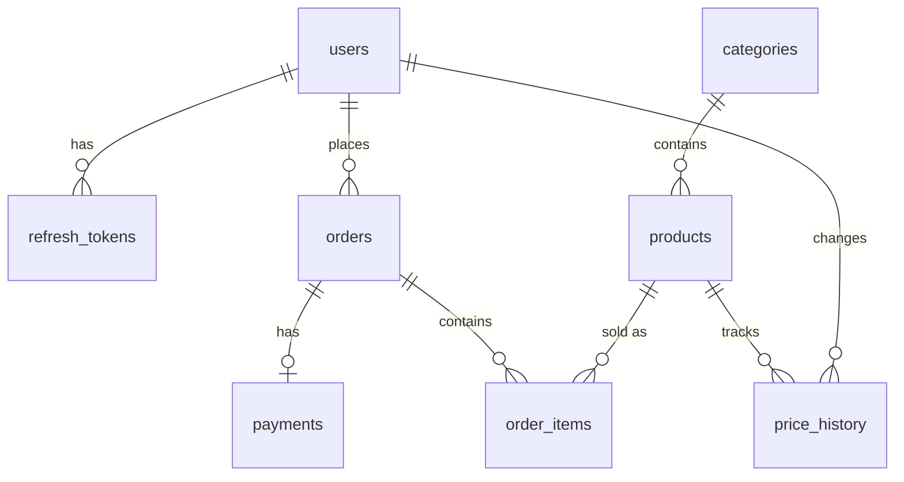

# Схема бази даних

Предметна область — магазин техніки. Покупець оформлює замовлення з кількох товарів. Адміністратор веде каталог і змінює ціни. Поточна ціна товару і ціна в уже створеному замовленні зберігаються окремо.

Схема в третій нормальній формі. Назва категорії не повторюється в кожному товарі, позиція замовлення посилається на товар, а не копіює його назву. Неключові стовпці залежать від первинного ключа свого рядка.

## Зв’язки

## Рішення

Категорія винесена в окрему таблицю, тому перейменування категорії не вимагає оновлювати товари. У `order_items.unit_price` записується ціна на момент покупки: пізніша зміна `products.price` не переписує суму старих замовлень. Історія цін лежить в `price_history`, а не в самому товарі, бо в товару завжди одна поточна ціна, а змін може бути багато.

`products.version` і `orders.version` дають оптимістичне блокування. Оновлення проходить лише тоді, коли клієнт надіслав той номер версії, який зараз у базі. Після успіху номер збільшується.

Користувача не видаляють фізично: `users.deleted_at` ховає обліковий запис, а замовлення лишаються для звітів. Скасоване неоплачене замовлення можна видалити фізично. Позиції й оплата зникають разом із ним через `ON DELETE CASCADE`. Товар при цьому не видаляється: на нього можуть посилатися інші замовлення, тому зовнішній ключ позиції на товар має `ON DELETE RESTRICT`.

Оплата зберігається окремим рядком, бо в замовлення один платіж, і його статус не збігається зі статусом доставки.

## Таблиця `users`

Призначення: облікові записи покупців і адміністраторів.

| Стовпець | Тип | Обмеження | Опис |
|----------|-----|-----------|------|
| id | UUID | PRIMARY KEY | Ідентифікатор |
| email | VARCHAR(255) | UNIQUE, NOT NULL | Пошта для входу |
| password_hash | VARCHAR(255) | NOT NULL | Хеш пароля bcrypt |
| name | VARCHAR(100) | NOT NULL | Ім’я |
| role | Role | NOT NULL, default `CUSTOMER` | `ADMIN` або `CUSTOMER` |
| created_at | TIMESTAMPTZ | NOT NULL, default `now()` | Час створення |
| updated_at | TIMESTAMPTZ | NOT NULL | Час останньої зміни |
| deleted_at | TIMESTAMPTZ | NULL | Мітка м’якого видалення |

Індекси:

- унікальний індекс на `email` для входу

Зв’язки:

- один-до-багатьох з `orders`
- один-до-багатьох з `refresh_tokens`
- один-до-багатьох з `price_history` через `changed_by`

## Таблиця `refresh_tokens`

Призначення: хеші refresh-токенів. Сам токен у базі не зберігається.

| Стовпець | Тип | Обмеження | Опис |
|----------|-----|-----------|------|
| id | UUID | PRIMARY KEY | Ідентифікатор |
| user_id | UUID | NOT NULL, FK | Власник токена |
| token_hash | VARCHAR(64) | UNIQUE, NOT NULL | SHA-256 хеш токена |
| expires_at | TIMESTAMPTZ | NOT NULL | Час закінчення дії |
| created_at | TIMESTAMPTZ | NOT NULL, default `now()` | Час видачі |

Індекси:

- унікальний індекс на `token_hash`
- `refresh_tokens_user_id_idx` на `user_id`

Зв’язки:

- багато-до-одного з `users`, `ON DELETE CASCADE`

## Таблиця `categories`

Призначення: розділи каталогу.

| Стовпець | Тип | Обмеження | Опис |
|----------|-----|-----------|------|
| id | UUID | PRIMARY KEY | Ідентифікатор |
| name | VARCHAR(100) | UNIQUE, NOT NULL | Назва |
| slug | VARCHAR(100) | UNIQUE, NOT NULL | Стале текстове ім’я для адреси |

Зв’язки:

- один-до-багатьох з `products`

## Таблиця `products`

Призначення: товари каталогу і їхній поточний залишок.

| Стовпець | Тип | Обмеження | Опис |
|----------|-----|-----------|------|
| id | UUID | PRIMARY KEY | Ідентифікатор |
| category_id | UUID | NOT NULL, FK | Категорія |
| sku | VARCHAR(50) | UNIQUE, NOT NULL | Артикул |
| name | VARCHAR(200) | NOT NULL | Назва |
| description | TEXT | NOT NULL | Опис |
| price | DECIMAL(10,2) | NOT NULL, CHECK `price > 0` | Поточна ціна |
| stock | INTEGER | NOT NULL, CHECK `stock >= 0` | Залишок |
| is_active | BOOLEAN | NOT NULL, default `true` | Чи можна замовити товар |
| version | INTEGER | NOT NULL, default `1` | Номер редакції для блокування |
| created_at | TIMESTAMPTZ | NOT NULL, default `now()` | Час створення |
| updated_at | TIMESTAMPTZ | NOT NULL | Час останньої зміни |

Індекси:

- унікальний індекс на `sku`
- `products_category_id_idx` на `category_id` для списку товарів категорії

Зв’язки:

- багато-до-одного з `categories`, `ON DELETE RESTRICT`
- один-до-багатьох з `order_items`
- один-до-багатьох з `price_history`

## Таблиця `orders`

Призначення: замовлення покупця.

| Стовпець | Тип | Обмеження | Опис |
|----------|-----|-----------|------|
| id | UUID | PRIMARY KEY | Ідентифікатор |
| user_id | UUID | NOT NULL, FK | Покупець |
| status | OrderStatus | NOT NULL, default `PLACED` | `PLACED`, `IN_TRANSIT`, `DELIVERED`, `CANCELLED` |
| total_amount | DECIMAL(12,2) | NOT NULL, CHECK `total_amount >= 0` | Сума позицій |
| version | INTEGER | NOT NULL, default `1` | Номер редакції для блокування |
| created_at | TIMESTAMPTZ | NOT NULL, default `now()` | Час створення |
| updated_at | TIMESTAMPTZ | NOT NULL | Час останньої зміни |

Індекси:

- `orders_user_id_status_idx` на `(user_id, status)` для вибірки замовлень покупця за статусом

Зв’язки:

- багато-до-одного з `users`, `ON DELETE RESTRICT`
- один-до-багатьох з `order_items`
- один-до-одного з `payments`

Дозволені переходи статусу: `PLACED` → `IN_TRANSIT` або `CANCELLED`, `IN_TRANSIT` → `DELIVERED` або `CANCELLED`. `DELIVERED` і `CANCELLED` далі не змінюються.

## Таблиця `order_items`

Призначення: один рядок — один товар у замовленні. Кількість лежить у `quantity`, тому той самий товар не повторюється другим рядком.

| Стовпець | Тип | Обмеження | Опис |
|----------|-----|-----------|------|
| id | UUID | PRIMARY KEY | Ідентифікатор |
| order_id | UUID | NOT NULL, FK | Замовлення |
| product_id | UUID | NOT NULL, FK | Товар |
| quantity | INTEGER | NOT NULL, CHECK `quantity > 0` | Кількість |
| unit_price | DECIMAL(10,2) | NOT NULL, CHECK `unit_price > 0` | Ціна за одиницю на момент покупки |

Індекси:

- унікальна пара `(order_id, product_id)`

Зв’язки:

- багато-до-одного з `orders`, `ON DELETE CASCADE`
- багато-до-одного з `products`, `ON DELETE RESTRICT`

## Таблиця `payments`

Призначення: одна оплата на замовлення.

| Стовпець | Тип | Обмеження | Опис |
|----------|-----|-----------|------|
| id | UUID | PRIMARY KEY | Ідентифікатор |
| order_id | UUID | UNIQUE, NOT NULL, FK | Замовлення |
| amount | DECIMAL(12,2) | NOT NULL, CHECK `amount > 0` | Сума |
| status | PaymentStatus | NOT NULL, default `PENDING` | `PENDING`, `PAID`, `FAILED` |
| paid_at | TIMESTAMPTZ | NULL | Час оплати |
| created_at | TIMESTAMPTZ | NOT NULL, default `now()` | Час створення |

Зв’язки:

- один-до-одного з `orders`, `ON DELETE CASCADE`

Жорстке видалення дозволене лише для замовлення зі статусом `CANCELLED` і оплатою `PENDING`.

## Таблиця `price_history`

Призначення: журнал зміни ціни. Рядок з’являється лише тоді, коли ціна справді змінилась.

| Стовпець | Тип | Обмеження | Опис |
|----------|-----|-----------|------|
| id | UUID | PRIMARY KEY | Ідентифікатор |
| product_id | UUID | NOT NULL, FK | Товар |
| changed_by | UUID | NOT NULL, FK | Адміністратор, який змінив ціну |
| old_price | DECIMAL(10,2) | NOT NULL, CHECK `old_price > 0` | Ціна до зміни |
| new_price | DECIMAL(10,2) | NOT NULL, CHECK `new_price > 0` | Ціна після зміни |
| changed_at | TIMESTAMPTZ | NOT NULL, default `now()` | Час зміни |

Індекси:

- `price_history_product_id_changed_at_idx` на `(product_id, changed_at)` для історії одного товару в часі

Зв’язки:

- багато-до-одного з `products`, `ON DELETE RESTRICT`
- багато-до-одного з `users`, `ON DELETE RESTRICT`
